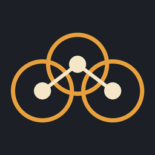
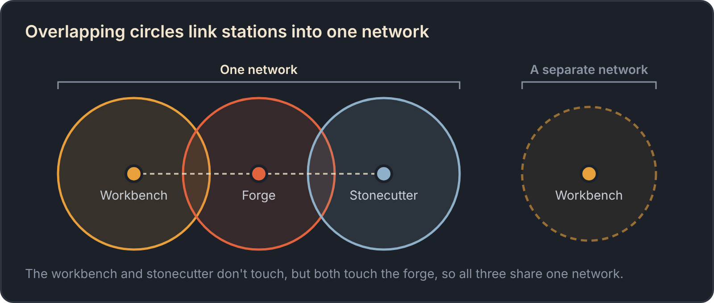
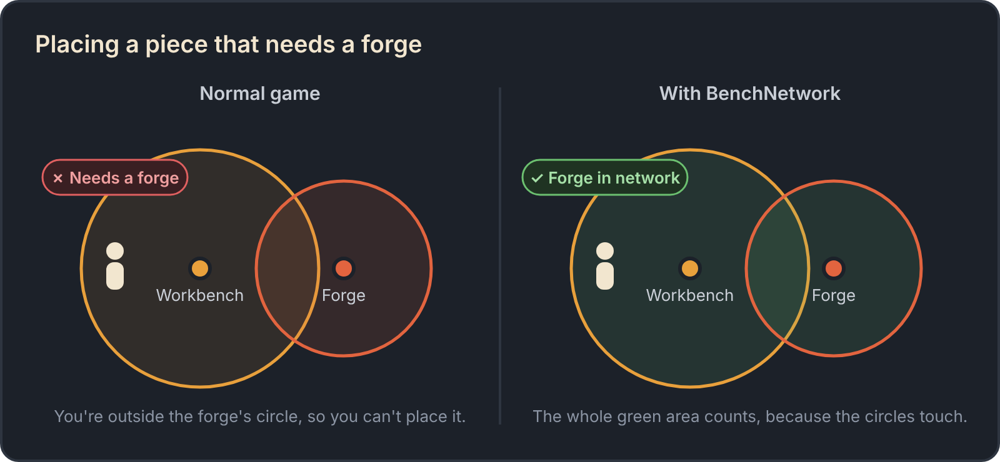
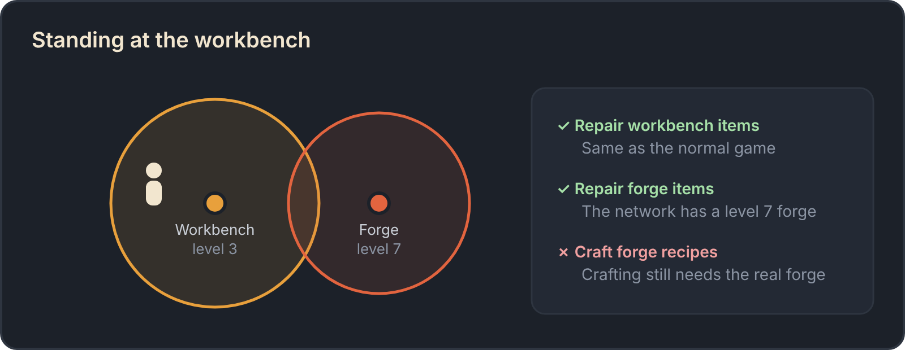
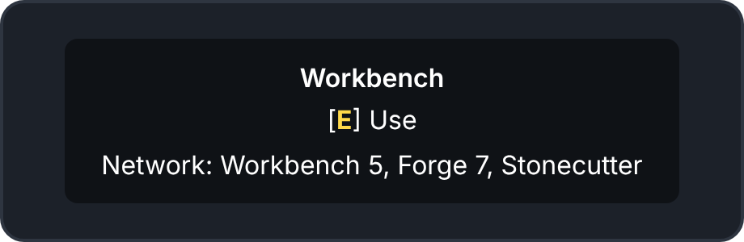

<h1 align="center">BenchNetwork</h1>

  Link your crafting stations together in Valheim. 
  Stop carrying a forge to every corner of your longhouse.

  <a href="https://valheim.hexium.gg/mods/M0zzy/BenchNetwork"><b>Get it on Hexium</b></a> ·
  <a href="https://github.com/m0zzy/Bench-Network/releases/latest">GitHub releases</a>

---

## What it does

In vanilla, every crafting station has a build radius: the glowing ring you see when you hold the Hammer near
it. To build a forge piece, you have to stand inside the forge's ring. Big bases end up with a spare forge and
stonecutter tucked into every corner just so you can keep building.

BenchNetwork lets your stations work together. When two stations' rings overlap, they **link** into a
**network**. Chain as many as you like: each station only has to touch one other station in the network.

### Build anywhere in your base

Stand anywhere inside your network and the Hammer acts as if every station in it were right next to you.
Building, deconstructing with the middle mouse button, and repairing pieces all work.

### Repair gear at any station

Back from the swamp with a battered iron mace? Hit **Repair** at your workbench. As long as your forge is in
the same network and upgraded enough, it works.

Each station type counts at its **highest level** in the network. If one forge has its bellows, anvils and
grinding wheel, the whole network has that forge level.

### See your network

Look at a station to see what it's linked to, with the best level of each station type:

Equip the Hammer and the outer edge of the network you're standing in lights up, so you can see exactly where
you can build. Press **F7** to turn this on or off whenever you like.

### Shield generator networks (experimental)

Shield generators whose domes overlap link up too. The game already blends overlapping domes into one bubble;
BenchNetwork makes them share **one fuel pool**. Feed bones to any generator in the chain and the fuel spreads
across all of them. Damage anywhere drains the whole pool, and when it runs dry every dome drops together.
Look at a generator to see how much fuel the network has left.

Server admins can also change the dome size.

## What's shared and what isn't

| | Shared across the network? |
| --- | :---: |
| Building with the Hammer | ✅ |
| Deconstructing pieces | ✅ |
| Repairing pieces with the Hammer | ✅ |
| Repairing gear at a station | ✅ if the network's station is a high enough level |
| Crafting | ❌ go to the real station |
| Spawn protection around your base | ❌ unchanged |
| Upgrade placement and station roof rules | ❌ unchanged |

## Installing

**With Gale:** search for **BenchNetwork**, click **Install**, and start Valheim from Gale. Gale installs
BepInEx and Jotunn for you.

Installing from a zip, or by hand

**From a zip:** download `BenchNetwork-<version>.zip` from the
[latest GitHub release](https://github.com/m0zzy/Bench-Network/releases/latest). Don't unzip it. In Gale, open
your profile and choose **Import → Local mod**, then pick the zip.

**By hand:** install [BepInExPack Valheim](https://thunderstore.io/c/valheim/p/denikson/BepInExPack_Valheim/)
and [Jotunn](https://thunderstore.io/c/valheim/p/ValheimModding/Jotunn/), unzip the release, and copy
`BenchNetwork.dll` into `BepInEx/plugins/BenchNetwork/` in your Valheim folder.

### Playing with friends

- **Everyone needs it**, including the server, and everyone needs the **same version**. If yours doesn't match,
  the game tells you when you join and won't let you in.
- **Dedicated servers** need BepInEx, Jotunn and BenchNetwork, same as players.
- **Single player** just works.

## Settings

You don't need to change anything. Out of the box everything is on and every station keeps its vanilla build
radius.

Open the in-game config menu with **F1** (needs
[ConfigurationManager](https://thunderstore.io/c/valheim/p/Azumatt/Official_BepInEx_ConfigurationManager/)),
or edit `BepInEx/config/m0zzy.BenchNetwork.cfg`.

**Yours to change, even on a server:**

- **Show network while building** and the **F7** key that toggles it.
- **Network circle style:** `Outline` shows just the network's edge; `AllCircles` shows every station's ring.
- **Show network in hover text:** the "Network:" line when you look at a station.

**Set by the server** (or by you in single player):

- **Build radius per station.** Want bigger rings so stations link from further apart? Each station has a
  *range* and a *range per level*. Leave them at `-1` to keep vanilla.
- **Link building** and **Link repair** switch each half of the mod on or off, and **Enabled** turns the
  whole thing off.

All settings

On a server, only the server's admins can change the settings marked *server*.

| Setting | Default | Who sets it | What it does |
| --- | --- | --- | --- |
| Enabled | On | server | Turns the whole mod off. Everything goes back to vanilla. |
| Link building | On | server | Build, deconstruct and repair pieces anywhere in a network. |
| Link repair | On | server | Repair gear from other stations in the network. |
| *Station* range | `-1` | server | Build radius at level 1. `-1` keeps vanilla. |
| *Station* range per level | `-1` | server | Extra radius for each station level. `-1` keeps vanilla. |
| Extra stations | Empty | server | Crafting stations from other mods that should join networks. See below. |
| Show network in hover text | On | you | The "Network:" line when you look at a station. |
| Show network while building | On | you | Lights up the network while you hold the Hammer. |
| Toggle network circles key | F7 | you | Turns the setting above on or off in game. |
| Network circle style | Outline | you | `Outline` or `AllCircles`. |
| Network refresh interval | `2` | you | How often, in seconds, networks are re-checked while you hold the Hammer. Best left alone. |
| Debug logging | Off | you | Writes extra detail to the log. Turn on when reporting a problem. |
| Link shield generators | On | server | Overlapping shield generators share one fuel pool. |
| Shield radius | `-1` | server | Dome radius with full fuel. `-1` keeps vanilla (30 m). |
| Shield radius when low on fuel | `-1` | server | Dome radius as fuel runs out. `-1` uses the same as *Shield radius*. |

There are range settings for the **Workbench, Forge, Stonecutter, Artisan table, Black forge** and
**Galdr table**. Change one and the ring around that station grows or shrinks to match.

**Crafting stations from other mods:** add each station's internal name to *Extra stations*, separated by
commas, for example `$piece_mystation`. To give it its own radius, add the range and the range per level
after colons: `$piece_mystation:30:4` is a 30 m ring that grows 4 m per level. The mod's author or its files
will have the internal name.

## Good to know

- **Only loaded areas count.** Valheim only loads the world near players, so if your network stretches a long
  way, the far end may not link up until someone's nearby.
- **Safe to remove.** Nothing is saved into your world. Everything you built stays put; you just need the right
  station nearby again to build more.
- **Can't join a server?** Make sure your BenchNetwork version matches the server's.

## Found a bug? Got an idea?

The log file tells us almost everything, so please include it:

1. Turn on **Debug logging** in the F1 menu.
2. Make the problem happen again. If you can, open the console with **F5** and type `benchnetwork` while
   standing where it happens. If F5 does nothing, add `-console` to Valheim's launch options.
3. Quit the game and grab `BepInEx/LogOutput.log` from your Gale profile folder. Valheim overwrites it every
   time it starts, so copy it before you play again.
4. [Open an issue](https://github.com/m0zzy/Bench-Network/issues/new/choose) and attach the log.

Ideas are welcome as issues too.

## For developers

How the mod works, how to build it and how releases are made: [docs/DEVELOPMENT.md](docs/DEVELOPMENT.md).

## License

BenchNetwork is free and open source under the [MIT License](LICENSE). Use it, change it and share it,
including in modpacks, as long as the license notice stays with it.

BenchNetwork is a fan-made mod and isn't affiliated with or endorsed by Iron Gate or Coffee Stain. Valheim is
a trademark of its owners.
